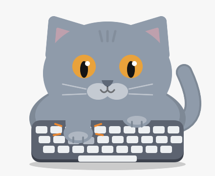
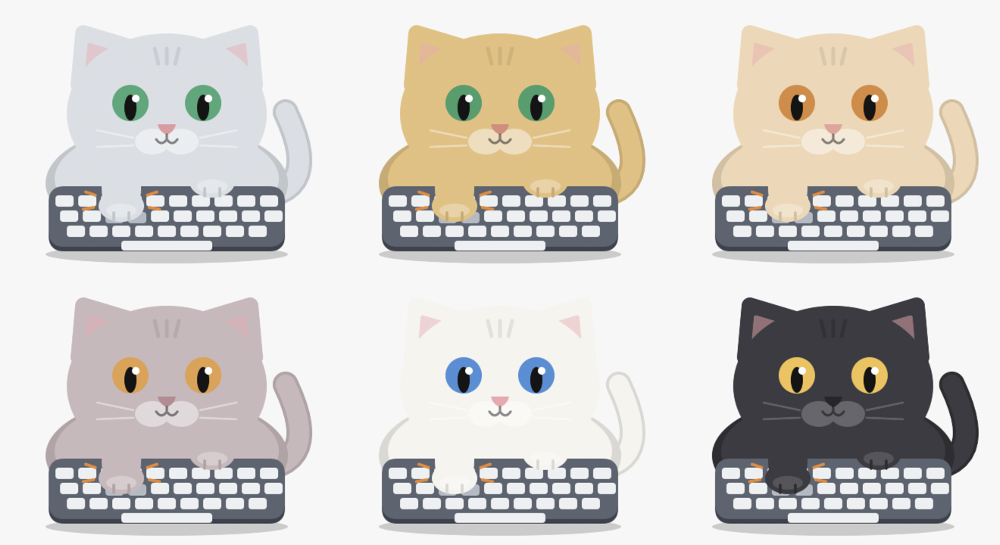

# TypingCat 🐱⌨️

一只趴在键盘上的扁平风英短猫。你在任何地方打字，它都会跟着拍键盘。

<p align="center"></p>

## 功能

| 打字中 | 打得飞快 | 睡着了 |
|:---:|:---:|:---:|
|  |  |  |
| 左右爪交替拍键盘，被拍到的键会凹下去 | 每秒 6 键以上：瞳孔放大、脸红、尾巴甩得更快 | 停止打字 30 秒后趴下睡觉，冒出 Zzz |

- **毛色可选**：蓝猫、银渐层、金渐层、奶油、丁香、白猫、黑猫，也可以用取色器自定义
- **菜单栏控制**：点菜单栏的小猫图标或右键猫咪，可以显示/隐藏、调大小、开鼠标穿透、设开机自启，还能看今天敲了多少下
- 拖动猫咪即可移动位置，下次启动会回到原处；不占 Dock

<p align="center"></p>

## 安装

需要 macOS 14 以上版本和 Xcode（或 Command Line Tools）。

```bash
git clone https://github.com/Leoyang158/TypingCat.git
cd TypingCat
./scripts/build_app.sh        # 编译并打包到 build/TypingCat.app
open build/TypingCat.app
```

第一次构建时，`build_app.sh` 会自动在登录钥匙串里生成一个本地自签名证书「TypingCat Dev」，用它给 App 签名。这样系统授权只需要做一次，之后重新构建也不会失效。

## 权限

macOS 要求全局监听键盘的 App 先获得授权。以下两种权限开一个就行：

- 系统设置 → 隐私与安全性 → **输入监控**（推荐）
- 系统设置 → 隐私与安全性 → **辅助功能**

没有权限时，猫头顶会出现「点我开启键盘权限」的气泡。点它会打开系统设置，授权后点「我已授权，重新启动」即可。

## 隐私

TypingCat 只统计"按了一下"这件事，**不读取、不记录、不上传任何按键内容**。唯一保存在本地的是今天的按键次数。

## 开发

```bash
swift build
.build/debug/TypingCat --snapshot /tmp/snap   # 把各种状态渲染成 PNG，方便检查画面
```

| 文件 | 作用 |
|---|---|
| `Sources/TypingCat/CatView.swift` | 猫和键盘的全部绘制 |
| `Sources/TypingCat/CatModel.swift` | 状态机（发呆 / 打字 / 兴奋 / 睡觉）和今日计数 |
| `Sources/TypingCat/CatTheme.swift` | 毛色预设 |
| `Sources/TypingCat/KeyboardMonitor.swift` | 全局键盘监听 |
| `Sources/TypingCat/AppDelegate.swift` | 浮动窗口、菜单栏、权限引导 |

诊断日志位于 `~/Library/Logs/TypingCat.log`。
