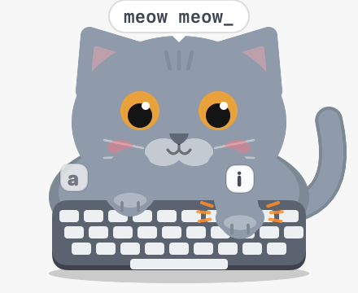
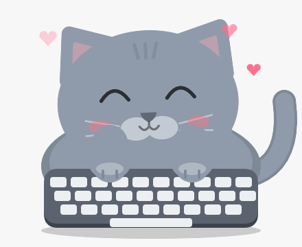
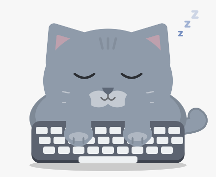

# TypingCat 🐱⌨️

一只趴在键盘上的扁平风英短猫。你在任何地方打字，它都会跟着拍键盘。

<p align="center"></p>

## 功能

| 打字中 | 打得飞快 | rua 它 | 睡着了 |
|:---:|:---:|:---:|:---:|
|  |  |  |  |
| 你按哪个键，猫就拍哪个键，字母从键上弹起，头顶显示打出的字 | 每秒 6 键以上：瞳孔放大、脸红、尾巴甩得更快 | 鼠标在猫头上来回蹭：眯眼、冒爱心、喵一声并打呼噜 | 30 秒没动静就趴下睡觉，冒出 Zzz |

- **眼睛跟着鼠标转**：不打字的时候，猫会一直盯着你的鼠标
- **会叫**：点猫一下会喵；rua 它会打呼噜。声音都是用代码实时合成的，可以在菜单里关闭
- **毛色可选**：蓝猫、银渐层、金渐层、奶油、丁香、白猫、黑猫，也可以用取色器自定义
- **菜单栏控制**：点菜单栏的小猫图标或右键猫咪，可以显示/隐藏、调大小、开鼠标穿透、设开机自启，还能看今天敲了多少下
- 拖动猫咪即可移动位置，下次启动会回到原处；不占 Dock
- **鼠标穿透**：开启后点击会直接落到猫后面的窗口上；按住 ⌘ 时可以临时拖动猫或右键打开菜单

<p align="center"></p>

## 下载使用（推荐）

1. 到 [Releases](https://github.com/Leoyang158/TypingCat/releases/latest) 下载 `TypingCat-x.y.z.zip`，解压后把 **TypingCat.app** 拖进「应用程序」文件夹。支持 Apple 芯片和 Intel，需要 macOS 14 以上。
2. 第一次打开时，macOS 会提示「无法验证开发者」，因为这个 App 没有经过 Apple 公证。任选一种方法放行：
   - 先双击一次，然后打开「系统设置 → 隐私与安全性」，在页面底部点 **「仍要打开」**
   - 或者在终端运行：`xattr -dr com.apple.quarantine /Applications/TypingCat.app`
3. 按提示在「隐私与安全性 → 输入监控」里打开 TypingCat，然后点「我已授权，重新启动」。

## 从源码构建

需要 macOS 14 以上版本和 Xcode（或 Command Line Tools）。

```bash
git clone https://github.com/Leoyang158/TypingCat.git
cd TypingCat
./scripts/build_app.sh        # 编译并打包到 build/TypingCat.app
open build/TypingCat.app
```

第一次构建时，`build_app.sh` 会自动在登录钥匙串里生成一个本地自签名证书「TypingCat Dev」，用它给 App 签名。这样系统授权只需要做一次，之后重新构建也不会失效。

## 权限

macOS 要求全局监听键盘的 App 先获得授权。以下两种权限开一个就行：

- 系统设置 → 隐私与安全性 → **输入监控**（推荐）
- 系统设置 → 隐私与安全性 → **辅助功能**

没有权限时，猫头顶会出现「点我开启键盘权限」的气泡。点它会打开系统设置，授权后点「我已授权，重新启动」即可。

## 隐私

为了让猫拍对应的键、显示你敲的字母，TypingCat 会读取按下的是哪个键。这些内容**只在屏幕上短暂显示**（字母约 1 秒，头顶那行字最多 18 个字符，停止打字 3 秒后消失），**不写入磁盘，也不上传**。唯一保存在本地的是今天的按键次数。

- 不想显示字母的话，在菜单里关掉「显示敲的字母」即可，猫照样会拍键盘
- 在密码输入框里，macOS 会屏蔽按键事件，TypingCat 收不到这些按键

## 开发

```bash
swift build
.build/debug/TypingCat --snapshot /tmp/snap   # 把各种状态渲染成 PNG，方便检查画面
./scripts/release.sh                          # 打包通用版 zip 到 dist/，用于发布
```

| 文件 | 作用 |
|---|---|
| `Sources/TypingCat/CatView.swift` | 猫和键盘的全部绘制 |
| `Sources/TypingCat/CatModel.swift` | 状态机（发呆 / 打字 / 兴奋 / 睡觉）和今日计数 |
| `Sources/TypingCat/CatTheme.swift` | 毛色预设 |
| `Sources/TypingCat/KeyboardMonitor.swift` | 全局键盘监听 |
| `Sources/TypingCat/AppDelegate.swift` | 浮动窗口、菜单栏、权限引导 |

诊断日志位于 `~/Library/Logs/TypingCat.log`。
